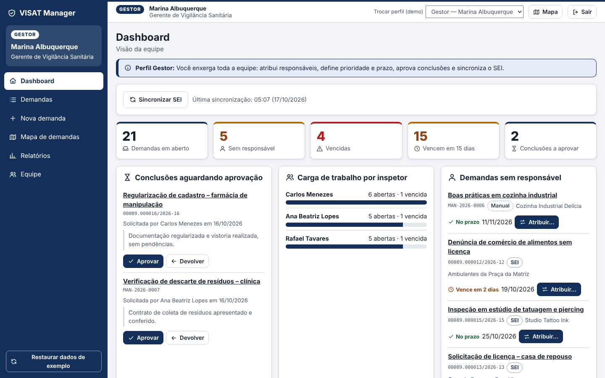

# VISAT Manager

**Gestão das demandas de Vigilância em Saúde do Trabalhador (VISAT) do Recife: centralizadas, rastreáveis e orientadas por dados.**

> CESAR School · Projeto 2 · **Grupo 6** · Prof. Danilo Barbosa
> Entrega: **Sprint 1** (histórias priorizadas + código inicial + evidências) · versão `0.1.0`



## O problema

A VISAT Recife recebe demandas do **Ministério Público do Trabalho**, de **sindicatos** e do **Conselho de Saúde**. Hoje o controle é feito em planilhas paralelas ao SEI, sem indicadores e sem rastreabilidade de prazos. O resultado são atrasos, retrabalho e risco institucional de descumprir prazos legais.

> **Desafio:** Como podemos transformar o processo de recebimento, acompanhamento e resposta às demandas de vigilância em saúde do trabalhador do Recife em um fluxo digital rastreável, integrado e orientado por dados, reduzindo atrasos, retrabalho e vulnerabilidade institucional?

## A solução

Uma plataforma web que **complementa o SEI, sem substituí-lo**. As demandas entram de duas formas, pela **sincronização com o SEI** ou por **cadastro manual**, e a partir daí seguem **um único fluxo**:

```
SEI → Sincronização ─┐
                     ├→ Banco central → Dashboard/Lista → Detalhe (Histórico/Documentos) → Linha do tempo → Conclusão
Cadastro manual ─────┘
```

### O que já funciona (Sprint 1)

| | Funcionalidade | História |
|---|---|---|
| 🔐 | Login com perfis **Gestor** e **Inspetor**; permissões validadas no servidor | US01 |
| 🔄 | **Coletor do SEI**: lê a exportação, valida, deduplica e importa (rodar 2× não duplica) | US02 |
| ✍️ | **Cadastro manual** com código `MAN-AAAA-NNNN` e prazo padrão por tipo | US03 |
| 📋 | **Painel central** com busca e filtros por status, prioridade, responsável, origem e prazo | US04 |
| 🕒 | **Linha do tempo**: Recebida → Triagem → Inspetor designado → Inspeção → Relatório → Concluída | US05 |
| 🚦 | **Radar de prazos**: Vencidas · Urgentes · Atenção · Prazo seguro, com alerta no sino | US06 |
| 📊 | **Dashboard**: recebidas, em andamento, concluídas, vencidas, tempo médio, % no prazo | US07 |
| 📎 | Observações e **documentos anexos** | US08 |
| 👥 | Atribuição de responsável e **carga por inspetor** | US09 · US10 |

## Como rodar

**Pré-requisito:** Python 3.11 ou superior.

**Windows:** dê dois cliques em `iniciar.bat`.
**Linux/macOS:** rode `./iniciar.sh`.

Ou faça manualmente:

```bash
python -m venv .venv && source .venv/bin/activate   # Windows: .venv\Scripts\activate
pip install -r requirements.txt
python -m backend.app.seed                           # banco de demonstração (dados fictícios)
python -m uvicorn backend.app.main:app --reload      # http://localhost:8000
```

| Perfil | E-mail | Senha |
|---|---|---|
| Gestor | `gestor@visat.demo` | `visat123` |
| Inspetor | `rodrigo@visat.demo` | `visat123` |

A tela de login também tem botões de acesso rápido para a demo.

### Rodar o coletor pelo terminal

```bash
python -m collector.run
# [collector] Lidos: 10 | Novos: 8 | Duplicados: 0 | Inválidos: 2
```

O mesmo pipeline roda pelo botão **"Sincronizar com SEI"** do dashboard do gestor.

### Testes e qualidade

```bash
python -m pytest     # 50 testes: regras de prazo, linha do tempo, permissões, coletor e API
ruff check .         # lint
```

API interativa (Swagger): http://localhost:8000/docs

## Estrutura

```
visat-manager/
├── backend/app/        # Lógica da aplicação (FastAPI)
│   ├── rules.py        #   regras puras: radar de prazos, etapas, permissões
│   ├── services.py     #   ponto único de entrada das demandas + indicadores
│   ├── models.py       #   banco: Usuario, Demanda, Movimentacao, Documento
│   ├── routers/        #   endpoints REST
│   └── seed.py         #   dados fictícios de demonstração
├── collector/          # Sincronização SEI (scraper v0)
│   ├── sources/        #   FonteDeDemandas + SeiMockSource
│   ├── normalizer.py   #   validação e mapeamento
│   └── pipeline.py     #   coletar → normalizar → deduplicar → gravar
├── frontend/           # Interface web (HTML/CSS/JS, segue os wireframes)
├── tests/              # pytest
├── docs/               # histórias, MoSCoW, arquitetura, decisões, evidências, apresentação
└── scripts/            # captura de evidências e reset da demo
```

## Documentação

- [Histórias de usuário priorizadas](docs/historias.md) e [backlog para o Trello (CSV)](docs/backlog_trello.csv)
- [MoSCoW revisado: antes × depois](docs/moscow.md)
- [Arquitetura implementada](docs/arquitetura.md)
- [Decisões técnicas, premissas e LGPD](docs/decisoes.md)
- [Evidências de funcionamento](docs/evidencias/)
- [Roteiro da apresentação](docs/apresentacao.md)
- [Como contribuir (branches e commits)](CONTRIBUTING.md)

## Roadmap

| Sprint | Foco (Trello) | Histórias |
|---|---|---|
| **1** ✅ | Priorização, início do código, scraper inicial, evidências | US01–US10 |
| 2 | Refinamento do scraper e pré-processamento | US11 agendamento + log · US12 configurações |
| 3 | Integração dos dados e primeiras visualizações | US13 dashboard analítico · US14 mapa |
| 4 | Ajustes pós-SR1 e incrementos | US15 notificações · US16 relatório PDF |
| 5 | Validação com o cliente | US17 gargalos + ajustes das entrevistas |
| Futuro | Integração real com WebServices do SEI (mediante autorização) | US18 |

## Equipe — Grupo 6

Lucas de Souza Rodrigues · Mateus de Lira Braga · Lucas Nery · Artur Holanda · Osmir Monteiro · Rafael de Andrade

> ⚠️ **Todos os dados do repositório são fictícios** (empresas, pessoas e números de processo). As demandas de saúde do trabalhador podem conter dados sensíveis (LGPD, art. 11).
