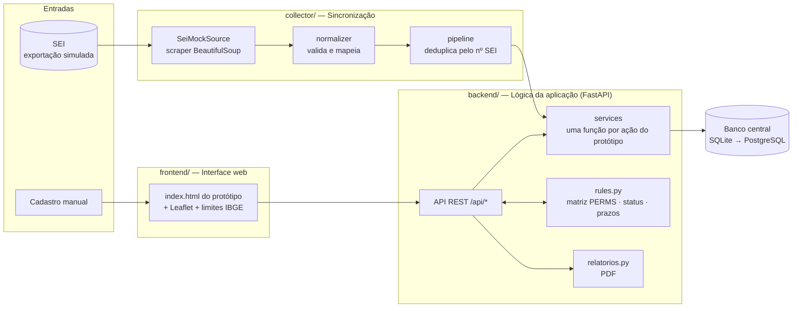
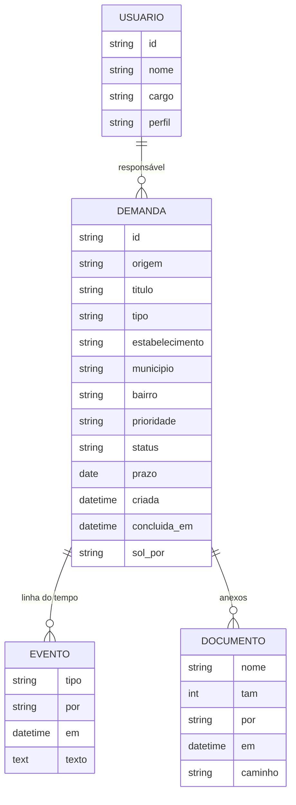
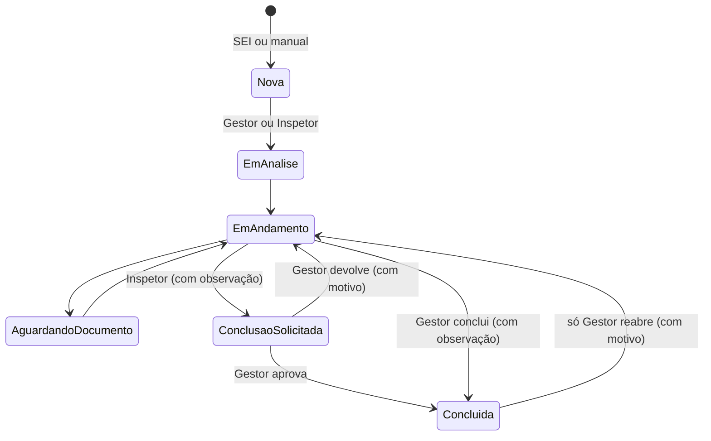

# Arquitetura implementada (Sprint 1)

Implementa as **três camadas** e as **duas entradas** da *Definição da Arquitetura da Solução*. A interface é o **protótipo validado (index.html)**, agora ligado a um servidor real.

## Do protótipo para o sistema

| No protótipo (só no navegador) | Agora |
|---|---|
| `estado.demandas` no `localStorage` | Banco de dados (tabelas `demandas`, `eventos`, `documentos`) |
| `PERMS` só na tela | A mesma matriz em `rules.py`, verificada **em toda chamada da API** |
| `SEED` de exemplo | `backend/app/seed.py`, com os mesmos dados e datas relativas a hoje |
| `sincronizar()` com modelos fixos | Coletor real: lê a exportação do SEI, valida, deduplica e grava |
| Anexo: só nome e tamanho | Arquivo enviado e guardado; pré-visualização de imagem e PDF |
| Relatórios só na tela | Mesmos indicadores + PDF do período e PDF de cada demanda |
| — | **Mapa de demandas** (nova tela, mesmo visual) |

## Fluxo de dados (documento oficial → código)

| Passo do fluxo oficial | Onde está |
|---|---|
| SEI → Sincronização | `collector/sources/sei_mock.py` → `normalizer.py` → `pipeline.py` → `services.registrar_sei()` |
| Cadastro Manual | `POST /api/demandas` → `services.criar_manual()` |
| → Banco de dados | SQLAlchemy (`models.py`) |
| → Dashboard / Lista | `GET /api/estado` (o protótipo calcula KPIs, filtros e gráficos na tela) |
| → Detalhes (Histórico/Documentos) | `GET /api/demandas/{id}`, `POST .../observacoes`, `POST .../documentos` |
| → Atualizações (Linha do tempo) | `POST .../status`, `.../gestao`, `/api/demandas/atribuir` |
| → Conclusão | `POST .../solicitar-conclusao` → `.../aprovar` ou `.../devolver` |

## Modelo de dados

## Ciclo de status

## Endpoints

| Método | Rota | Quem | História |
|---|---|---|---|
| POST | `/api/login` · `/api/logout` · GET `/api/usuarios` | todos | US01 |
| GET | `/api/estado` | todos (inspetor recebe só as suas) | US04 · US08 |
| POST | `/api/sync/sei` | Gestor | US02 |
| POST | `/api/demandas` | todos | US03 |
| GET | `/api/demandas/{id}` | com acesso | US05 |
| POST | `/api/demandas/{id}/status` | conforme `PERMS` | US06 |
| POST | `/api/demandas/{id}/solicitar-conclusao` · `/aprovar` · `/devolver` | Inspetor / Gestor | US06 |
| POST | `/api/demandas/atribuir` · `/api/demandas/{id}/gestao` | Gestor | US09 |
| POST/GET | `/api/demandas/{id}/observacoes` · `/documentos` | dono da demanda ou Gestor | US10 |
| GET | `/api/mapa` | todos | US11 |
| GET | `/api/relatorios.pdf` · `/api/demandas/{id}/relatorio.pdf` | todos (escopo do perfil) | US12 |
| POST | `/api/restaurar` | todos (demonstração) | — |

Documentação interativa: `http://localhost:8000/docs`.

## Mapa

- Biblioteca **Leaflet 1.9.4**, incluída no repositório (`frontend/vendor/`): funciona sem CDN.
- **Limites municipais do IBGE** da Região Metropolitana do Recife (`frontend/data/rmr_municipios.geojson`, simplificado a 16 KB): o mapa aparece mesmo sem internet.
- Com internet, o mapa de ruas do OpenStreetMap aparece por baixo.
- Posição: bairro do Recife (ponto aproximado do bairro) ou centro do município. Geocodificação por endereço é a US17.
