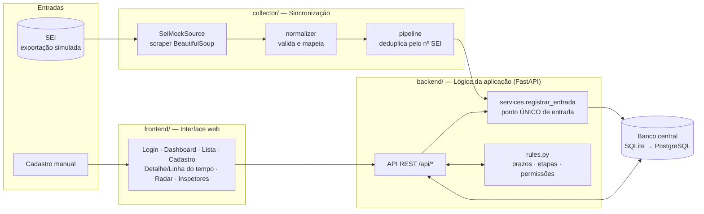
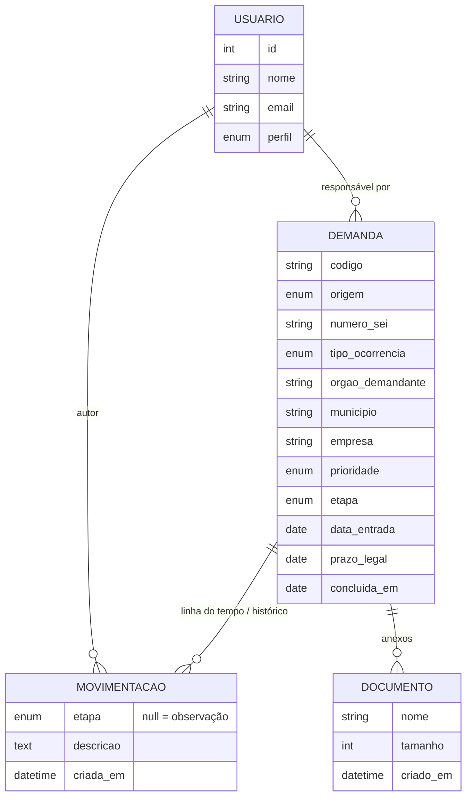
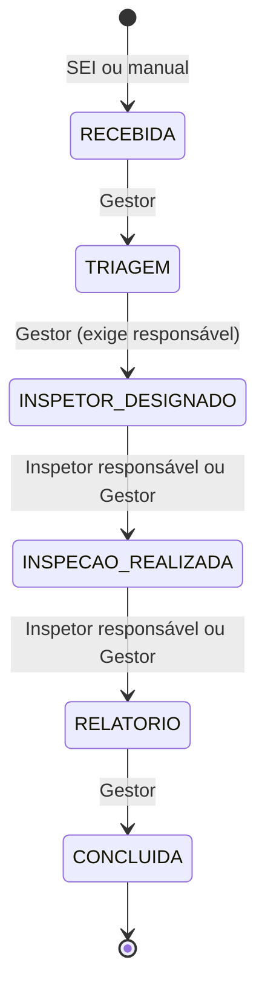

# Arquitetura implementada (Sprint 1)

Implementa as **três camadas** e as **duas entradas** da *Definição da Arquitetura da Solução*.

## Fluxo de dados (documento oficial → código)

| Passo do fluxo oficial | Onde está no código |
|---|---|
| SEI → Sincronização | `collector/sources/sei_mock.py` → `collector/normalizer.py` → `collector/pipeline.py` |
| Cadastro Manual | `POST /api/demandas` (`routers/demandas.py`) |
| → Sistema/banco de dados | `services.registrar_entrada()`: **as duas origens passam pela mesma função** |
| → Dashboard / Lista de Demandas | `GET /api/dashboard`, `GET /api/demandas` (filtros: status, prioridade, responsável, origem) |
| → Detalhes (Histórico/Documentos) | `GET /api/demandas/{id}`, `POST .../observacoes`, `POST .../documentos` |
| → Atualizações (Linha do tempo) | `POST .../avancar`, com validação em `rules.validar_transicao()` |
| → Conclusão | etapa `CONCLUIDA`, registra `concluida_em` (alimenta tempo médio e % no prazo) |

## Modelo de dados

**Saúde da demanda não é gravada no banco.** Ela é calculada na hora (`rules.classificar_prazo`), a partir do prazo legal e da data de hoje. Assim nunca fica desatualizada.

## Máquina de estados da Linha do Tempo

## Endpoints

| Método | Rota | Perfil | História |
|---|---|---|---|
| POST | `/api/auth/login` · `/api/auth/logout` · GET `/api/auth/me` | todos | US01 |
| POST | `/api/sync/sei` | Gestor | US02 |
| POST | `/api/demandas` | todos | US03 |
| GET | `/api/demandas` | todos (inspetor vê só as suas) | US04 |
| GET | `/api/demandas/{id}` | com acesso | US05 |
| POST | `/api/demandas/{id}/avancar` | conforme etapa | US05 |
| POST | `/api/demandas/{id}/observacoes` · `/documentos` | com acesso | US08 |
| POST/PATCH | `/api/demandas/{id}/atribuir` · `/api/demandas/{id}` | Gestor | US09 |
| GET | `/api/radar` | todos | US06 |
| GET | `/api/dashboard` · `/api/inspetores` | todos | US07 · US10 |

A documentação interativa fica em `http://localhost:8000/docs` (Swagger, gerado pelo FastAPI).
